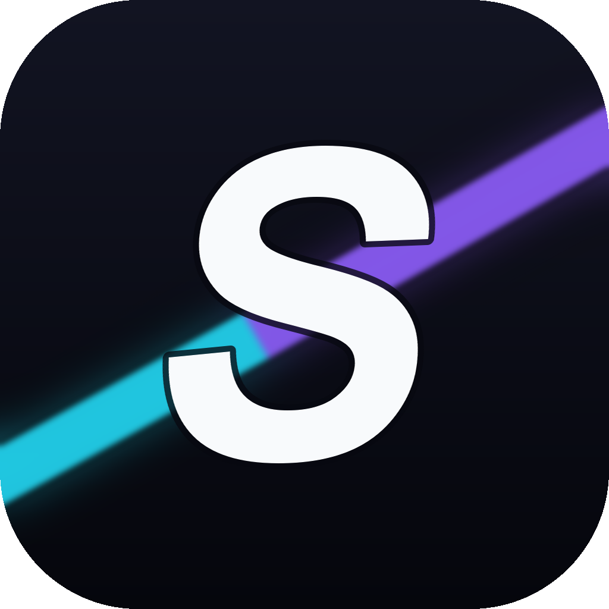

<p align="center">
  
</p>

<h1 align="center">SiFlux Studio</h1>

<p align="center"><strong>本地优先的 AI 图片创作工作台</strong></p>

<p align="center">
  在一个自由画布里完成构思、生成与整理。<br>
  项目与素材保存在本机，模型经内置 SiFlux 中转站调用。
</p>

<p align="center">
  <a href="https://github.com/Aa1689756333/SiFlux-Studio/releases/latest">
    
  </a>
  <a href="https://github.com/Aa1689756333/SiFlux-Studio/releases/latest">
    
  </a>
  <a href="LICENSE"></a>
</p>

<p align="center">
  <a href="https://github.com/Aa1689756333/SiFlux-Studio/releases/latest"><strong>⬇ 下载最新版</strong></a>
</p>

## 当前版本

**1.0.3** 只开放**图片生成**。视频、音频、3D 导演台、Agent 助手与 MCP 集成仍在开发中，界面上暂不显示。安装本版本后，可在软件内检查并安装后续更新。

## 能做什么

- **画布生图**：提示词直接生成，结果落在画布节点上，可继续引用、重绘、组合
- **参考图**：以已有图片作为参考，控制风格与构图
- **批量与比例**：一次多张，预设常见画幅
- **项目库**：项目、画布与素材保存在本机，随时继续
- **本地优先**：数据在本地，只有生成请求会发往中转站

## 下载与安装

1. 打开 [Releases](https://github.com/Aa1689756333/SiFlux-Studio/releases/latest)
2. 下载 `SiFlux-1.0.2-amd64-installer.exe`
3. 运行安装程序

要求 Windows 10/11 x64，系统需具备 WebView2（Win11 自带，Win10 安装程序会提示）。

首次启动后：**模型配置 → SiFlux 中转站 → 填写 API Key → 读取模型 → 选择默认生图模型**。

## 从源码构建

### 依赖

| 用途 | 依赖 |
| --- | --- |
| 前端 | Node.js 20+、Bun |
| 后端 | Go 1.22+、MinGW-w64（SQLite 需要 CGO） |
| 桌面端 | Wails v2 CLI、NSIS（打安装包时） |

### 构建

```bash
# 前端依赖
cd web
bun install

# 桌面应用 + 安装包
cd ../backend/cmd/desktop
wails build -clean -nsis \
  -ldflags "-X infinite-canvas/backend/internal/buildinfo.Version=1.0.0"
```

产物：

```text
backend/cmd/desktop/build/bin/SiFlux.exe
backend/cmd/desktop/build/bin/SiFlux-amd64-installer.exe
```

### 开发模式

```bash
# 终端 1：前端
cd web && bun run dev

# 终端 2：后端
cd backend && go run ./cmd/server
```

桌面端调试可用 `wails dev`。

## 目录结构

```text
web/                 React 前端（Vite）
backend/             Go 后端与桌面壳（Wails）
  cmd/desktop/       桌面应用入口
  cmd/server/        独立后端
  internal/          业务、存储、插件运行时
plugin-packages/     内置模型协议插件
scripts/             构建与发布脚本
```

## 版本开关

首发版本用一个编译期开关控制可见功能：

```ts
// web/src/lib/release-flags.ts
export const IMAGE_ONLY_RELEASE = true;
```

改为 `false` 后重新构建，即可恢复全部入口，不需要回滚界面代码。

## 许可证

[MIT](LICENSE)
